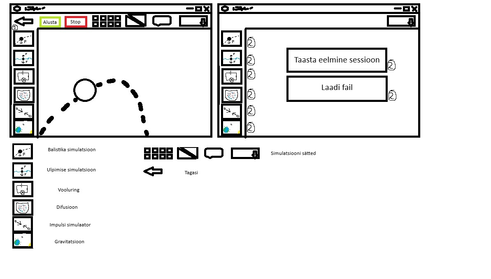

# suurITpunkt
Programmeerimine 4
Nimed:
Jaanus Liiv
Edgard Liskman
Pavel Terentjev

Probleem: Tahaksime mingit "tööriista", millega füüsikat harjutada
Rollid: 
Jaanus - füüsik
Edgard - füüsik
Pavel - füüsik

Lühikirjeldus: Füüsika ülesannete simulaator, (7-12 klass?). 
https://trello.com/invite/b/6aa246e9a470e1d5b4301b21/ATTI8ab865520ef5afd2b4f03776f5d375204FE6F301/projekt

